# Enrollment system: actions and flowcharts

Updated October 17, 2026. These charts describe current application behavior, including enrollment corrections, voiding, admin reopening, and mandatory completed Registrar meetings before reenrollment for current failed grades. Unfinished controls are identified separately. Open this file in a Mermaid-capable Markdown preview to render the diagrams.

**Reading guide:** rectangles are actions/results; diamonds are checks. A confirmation's **Cancel/No** path stops without saving unless stated otherwise. Database updates and email delivery are separate steps.

## Contents

1. [System overview and access](#1-system-overview-and-access)
2. [Create students and registrars](#2-create-students-and-registrars)
3. [Account setup, sign-in, and password recovery](#3-account-setup-sign-in-and-password-recovery)
4. [Enrollment eligibility and defaults](#4-enrollment-eligibility-and-defaults)
5. [Enrollment editor and saving](#5-enrollment-editor-and-saving)
6. [Failed and incomplete subjects](#6-failed-and-incomplete-subjects)
7. [Editing and finalizing grades](#7-editing-and-finalizing-grades)
   - [Correcting, voiding, and reopening enrollment](#7a-correcting-voiding-and-reopening-enrollment)
8. [Clearance and completion](#8-clearance-and-completion)
9. [Meeting requests and completing follow-ups](#9-meeting-requests-and-completing-follow-ups)
10. [Dropping and reenrolling](#10-dropping-and-reenrolling)
11. [Curriculum creation and lifecycle](#11-curriculum-creation-and-lifecycle)
12. [Programs and subjects](#12-programs-and-subjects)
13. [Student dashboard, enrollment, curriculum, and profile](#13-student-dashboard-enrollment-curriculum-and-profile)
14. [Search, filters, history, and pagination](#14-search-filters-history-and-pagination)
15. [Email settings](#15-email-settings)
16. [Errors and shared controls](#16-errors-and-shared-controls)
17. [Unfinished screens and controls](#17-unfinished-screens-and-controls)
18. [Backend action index](#18-backend-action-index)

## 1. System overview and access

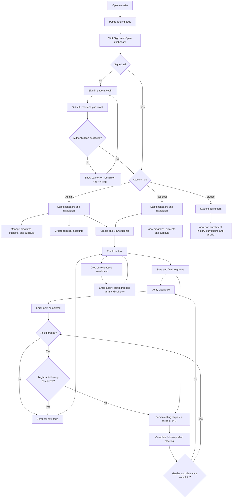

| Capability                                            | Admin                                                  | Registrar                                   | Student                      |
| ----------------------------------------------------- | ------------------------------------------------------ | ------------------------------------------- | ---------------------------- |
| Create/view students; enroll students                 | Yes                                                    | Yes                                         | No                           |
| View student masterlist by term and class             | Yes                                                    | Yes                                         | No                           |
| Generate reports, export CSV, and print               | Yes                                                    | Yes                                         | No                           |
| Create/list registrar accounts                        | Yes                                                    | No                                          | No                           |
| Delete unfinished students without enrollment history | Yes                                                    | Yes                                         | No                           |
| Disable/enable registrar accounts                     | Yes                                                    | No                                          | No                           |
| Delete registrar accounts                             | Yes                                                    | No                                          | No                           |
| Revoke account sessions                               | Students and registrars                                | Students only                               | No                           |
| Manage programs, subjects, curricula                  | Yes                                                    | View only                                   | Own assigned curriculum only |
| Edit grades                                           | Current/historical, unfinalized only                   | Current, unfinalized only                   | No                           |
| Finalize grades                                       | Current/historical, not already finalized              | Current, not already finalized              | No                           |
| Correct enrollment details and subjects               | Current/historical, status `enrolled`, unfinalized     | Current, status `enrolled`, unfinalized     | No                           |
| Void incorrect enrollment                             | Current/historical, unfinalized and not already voided | Current, unfinalized and not already voided | No                           |
| Reopen finalized enrollment with reason               | Current/historical, enrolled or completed              | No                                          | No                           |
| Verify clearance; send/complete follow-up             | Yes, subject to enrollment checks                      | Yes, subject to enrollment checks           | No                           |
| Drop enrollment                                       | Current, status `enrolled`                             | Current, status `enrolled`                  | No                           |
| Configure outgoing email                              | Yes                                                    | No                                          | No                           |
| View own profile                                      | Yes                                                    | Yes                                         | Yes                          |

Grade editing/finalization always requires completed student account setup, unfinalized grades, and an enrollment that is neither dropped nor voided. Finalized grades are locked for both roles until an admin explicitly reopens the enrollment with a reason. Role restrictions are checked on the server as well as reflected in the UI. Public sign-up is disabled.

## 2. Create students and registrars

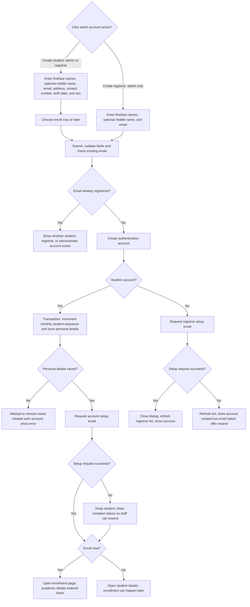

- Student numbers use `MA-YYYYMM-000001`; numbering resets monthly using Manila time.
- Creating a student does not create an enrollment. Program, year, semester, section, and subjects are saved when enrolling.
- No applicant record or document uploads are involved.
- **Resend verification** on an unfinished student/registrar account requests another setup link. Despite the backend name `resendMagicLink`, this uses password-reset account setup, not passwordless login.
- Staff setup-link requests check the actual email delivery result, including provider failures Better Auth suppresses. Failed invitations keep the saved account and show an email-failure message with a resend option; they do not show a delivery-success message. Delivery results stay separate for concurrent requests. Public password-recovery responses retain their generic account-privacy behavior.
- Email outcomes here reflect the setup-request code's success/error result, not proof that the recipient received the message.

## 3. Account setup, sign-in, and password recovery

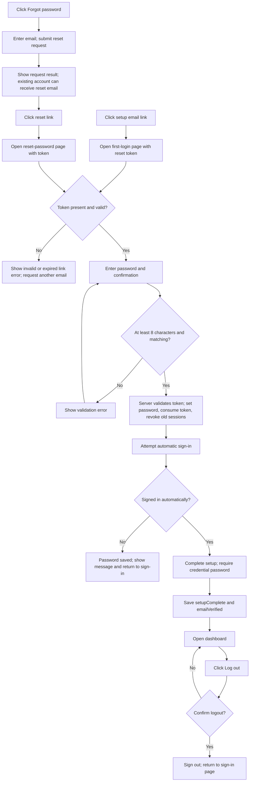

Setup/reset links expire after 24 hours. Both password pages call the same reset/sign-in and setup-completion commands. If password reset succeeds but sign-in fails, the UI directs the user to `/login` with the new password rather than reuse the consumed token. `/` is a public landing page, including for signed-in users; opening `/login` while signed in redirects to the dashboard. Logout returns to `/login`.

## 4. Enrollment eligibility and defaults

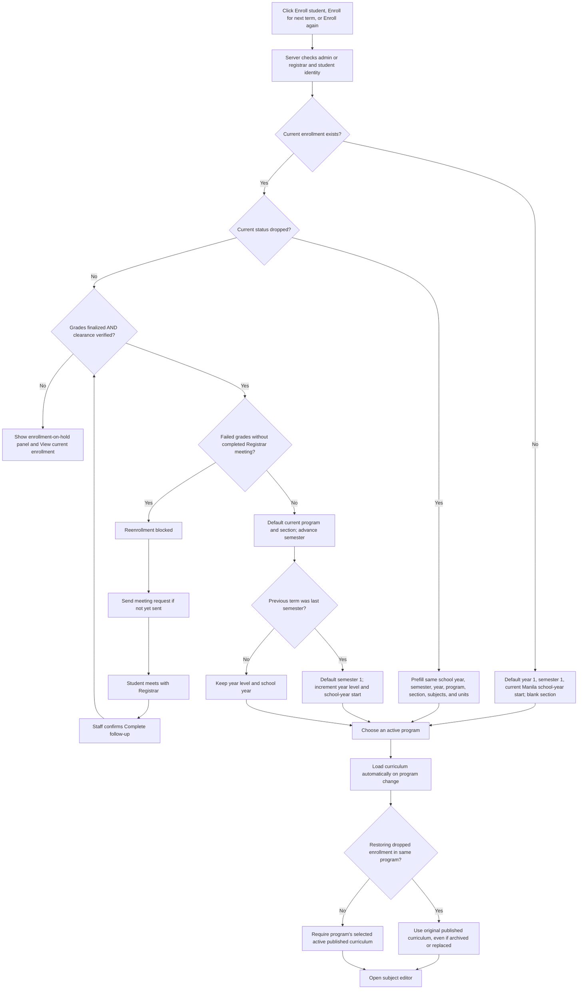

Defaults are editable; reenrollment creates a new record. Restoring a dropped enrollment permits the same term and bypasses its grades/clearance completion gate. Ordinary reenrollment must be for a later term. Year/semester must fit the selected curriculum; the editor clamps initial defaults to its limits.

An absent/inactive program or unavailable curriculum stops loading with an actionable error. Reenrollment checks run again when saving, so an old open form cannot bypass changed enrollment or curriculum state.

## 5. Enrollment editor and saving

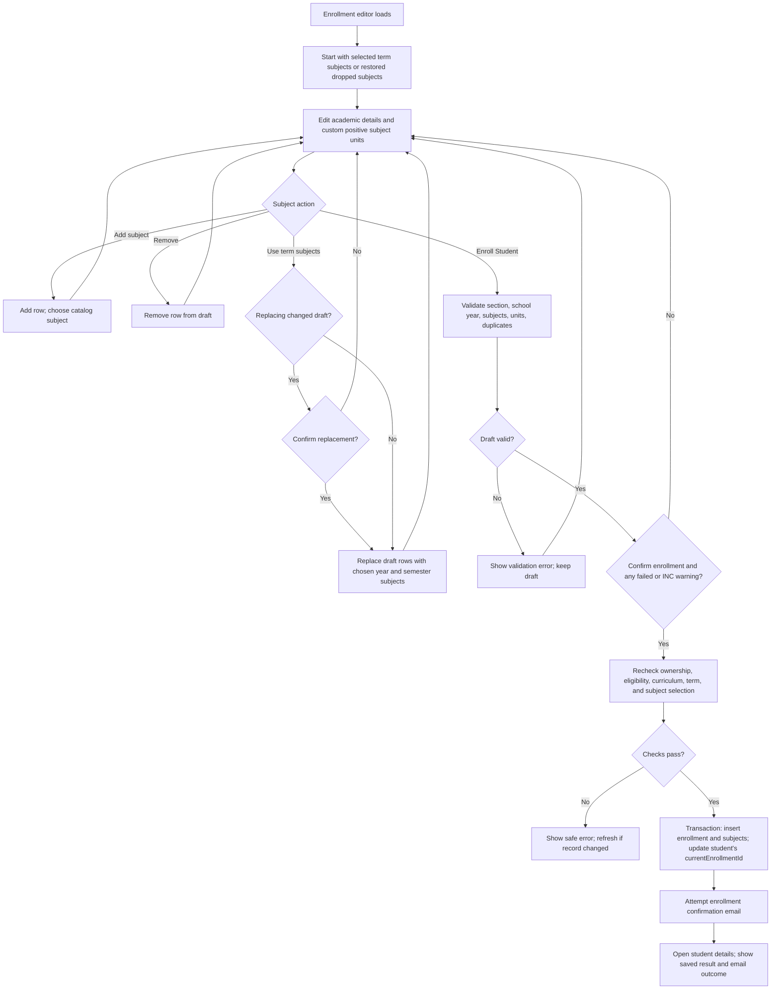

- Same-year/semester subjects in the selected curriculum are marked **curriculum**. Other selected subjects are **extra**, including subjects from another year/semester.
- Curriculum subject names/codes come from published snapshots; extra subject names/codes come from the catalog. Custom positive units are accepted for both.
- Duplicate enrollment for the same student, school year, and semester is rejected unless the existing attempt is dropped or voided. Duplicate subject rows are rejected.
- Changing **program** reloads its curriculum automatically. Changing **year/semester** changes the term selection; **Use term subjects** explicitly replaces rows. Existing selections are not silently discarded.
- Leaving a changed draft or switching programs asks to discard unsaved work. Cancel keeps the draft and restores program selection.
- Once saved, resubmission is blocked even if navigation fails. An enrollment-confirmation email failure does not undo enrollment.

## 6. Failed and incomplete subjects

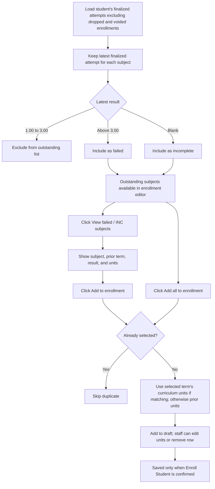

This list can include earlier terms. The reenrollment confirmation warning specifically checks the current enrollment's finalized failed/INC grades. Failed grades (above 3.00) in the current valid enrollment require a completed Registrar follow-up before reenrollment; sending the meeting email alone is insufficient. Both staff roles must meet this requirement. INC-only grades retain the acknowledgment warning without requiring a completed meeting. Completing a meeting does not clear those grades or remove the warning. Voided attempts do not contribute grades or enrollment requirements.

## 7. Editing and finalizing grades

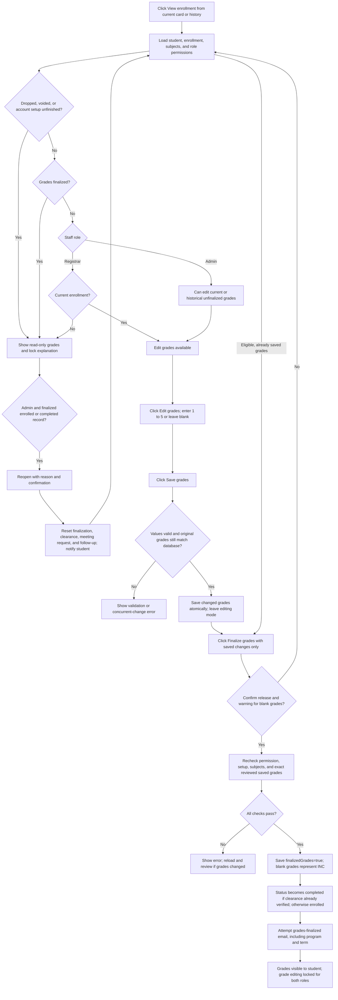

Grade meanings: **1.00–3.00 = passed**, **above 3.00–5.00 = failed**, **null before finalization = no grade**, **null after finalization = INC**. INC is represented by a null value plus finalized state, not by storing the text `INC` in the grade column.

**Cancel editing** restores saved grades; dirty drafts require confirmation. Navigating away from unsaved grades also prompts. Finalization does not save an unsaved grade draft. After reopening, an admin can correct details/grades, finalize again to release them and send a new finalization notice, then verify clearance again. Reopening alone sends its own enrollment-update email; it does not finalize grades.

## 7a. Correcting, voiding, and reopening enrollment

Open **View enrollment**, then choose the correction action. **Edit enrollment** opens `/user/students/[userId]/enrollments/[enrollmentId]/edit`. Both roles can correct current unfinalized enrollments with status `enrolled`; only admins can correct historical records. A dropped enrollment can be voided if it is unfinalized, but cannot be edited or reopened.

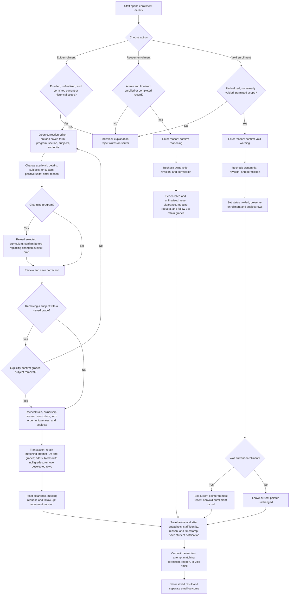

Matching subjects retain their attempt IDs, grades, and original staff attribution even after program changes. Newly added subjects start without grades. Removed graded subjects remain available in the audit's before snapshot. Replacing draft subjects requires confirmation; saving a correction also requires explicit acknowledgment when removing any graded subject. Corrections cannot cross the student's earlier/later valid enrollment terms or create a duplicate valid enrollment for a term.

Voiding records an enrollment entered in error; **Drop enrollment** remains the action for an actual withdrawal. Voided records stay visible in enrollment history and staff audit, but are excluded from academic reports, masterlists, grade outcomes, failed/INC calculations, and reenrollment requirements. They do not consume the unique student/term slot, so staff can create a correct enrollment for that same term. A restored previous current enrollment still imposes its own normal reenrollment requirements.

Every correction, void, and reopen saves audit snapshots and a student notification in the same transaction. Notification visibility remains student recipient / acting registrar / all admins. Email failure does not undo saved changes. Stale revisions and an active meeting-email send claim reject changes without partial updates. Reopened provisional grades remain hidden from students until finalized again.

Migration `0030_smiling_microbe` adds `voided`, the revision counter, and enrollment audit storage. It preserves existing enrollment IDs, grades, student pointers, and notification links, including when foreign keys are enabled. Its guarded rollback refuses while audit entries or voided rows exist, rather than discarding them.

## 8. Clearance and completion

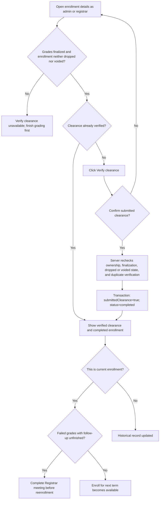

`completed` means grades finalized **and** clearance verified; it does not mean every subject passed. Failed/INC grades do not prevent clearance verification. Clearance verification sends no separate email. The current-enrollment pointer remains on this record until a new enrollment replaces it.

For a current enrollment with failed grades, `completed` status alone does not make the student ready for reenrollment. The Registrar meeting must also be recorded as completed; both admin and registrar are subject to this check.

## 9. Meeting requests and completing follow-ups

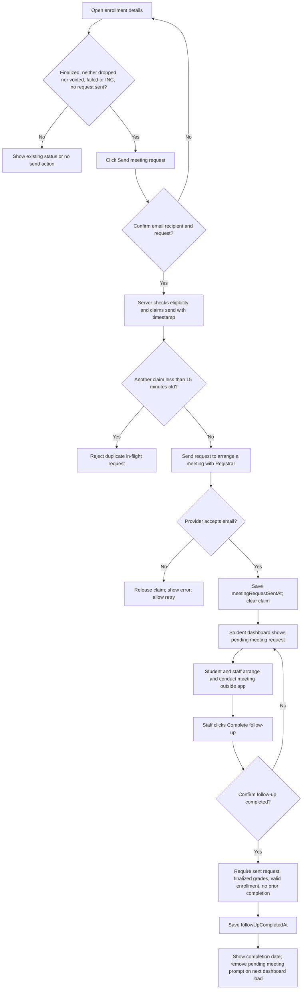

- Expired send claims can be retried after 15 minutes. A sent request cannot be sent again through this action.
- If delivery succeeds but the send claim changed before saving the result, the server asks staff to refresh rather than silently claim success.
- Pending meeting prompts can include historical enrollments. They disappear when follow-up completes, enrollment is dropped or voided, or its grades are reopened. Reopening and correcting enrollment reset the meeting request and completed follow-up; staff must reassess the corrected results after finalizing again.
- Completing follow-up changes only its timestamp. It does not change grades, clearance, or enrollment status, and sends no completion email.
- Current enrollment failures block reenrollment until this completion is recorded. The Next term dashboard worklist and enrollment buttons follow the same requirement; the enrollment command rechecks it inside its transaction.
- Meeting requests do not schedule a date/time automatically.

## 10. Dropping and reenrolling

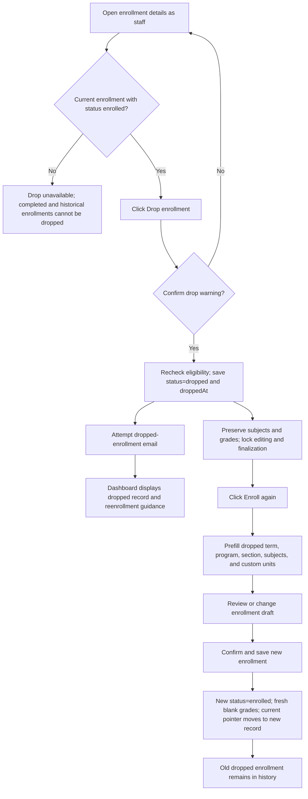

Dropping does not delete records or clear the current-enrollment pointer. Drop notices remain available from history on the dashboard after reenrollment. Dropped subject attempts are excluded from outstanding failed/INC calculations.

## 11. Curriculum creation and lifecycle

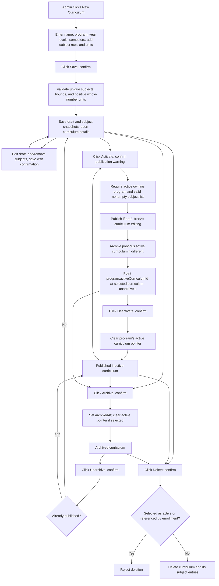

- Published curricula cannot be edited. Build a new curriculum as a revision; activating it does not migrate existing enrollments.
- Editing an archived draft redirects to details; unarchive before editing.
- Subject codes/names are copied from the catalog by the server when saving drafts and refreshed when first published.
- Subject layout controls switch between all terms and a selected year/semester. They change presentation, not saved data.
- Creating a program or subject from the curriculum editor opens the corresponding catalog dialog; a successful creation becomes available for selection.
- Reducing year/semester limits cannot silently save subject rows outside the new limits; validation stops the save.
- Students keep viewing the curriculum referenced by their current enrollment, even after the program selects another version.

## 12. Programs and subjects

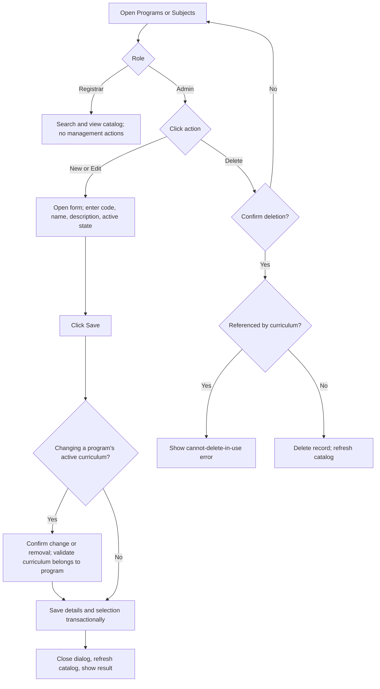

Program active-curriculum selection uses the same publication/activation rules as the curriculum page. Clearing its selection leaves no active curriculum. Program active state controls availability for new enrollment. Published curriculum snapshots and recorded enrollment subjects preserve their stored names/codes when catalogs change.

`setProgramStatus` and `setSubjectStatus` also exist as server commands. Current forms save active/inactive state through `createProgram`/`updateProgram` and `createSubject`/`updateSubject`; the dedicated status commands have no separate current button.

## 13. Student dashboard, enrollment, curriculum, and profile

**Staff dashboards:** admin and registrar dashboards load live aggregates from `+page.server.ts`. Both show current-enrollment totals, six-month enrollment activity, active enrollment counts by program, released grade outcomes, recent enrollments, and worklists for grades, clearance, follow-ups, setup, and next-term readiness. Click a worklist category to switch its preview; click a row action to open the student or enrollment record. Counts cover all matching records; previews show up to six, oldest terms first. Follow-ups include unresolved historical terms. Create student opens the existing dialog. Program bars link to the student list filtered by program (all enrollment statuses). Admin additionally sees registrar-account and catalog health; registrar sees next-term readiness guidance. Data refreshes on page load; no dashboard action automatically sends email or changes academic records.

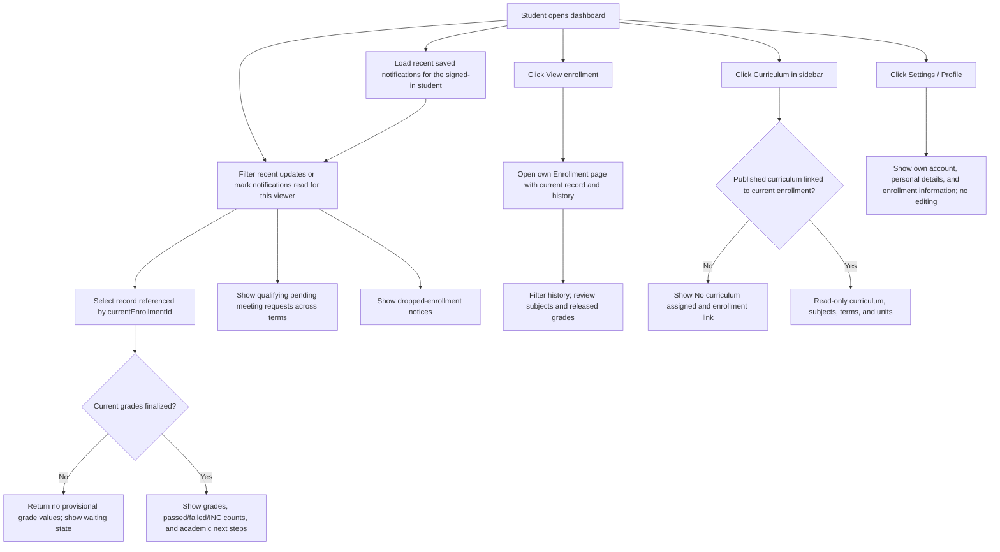

Student data is scoped to the session. Students cannot open another curriculum ID; it returns not found. Unfinalized grades are hidden from student enrollment history and dashboard data, not merely hidden by CSS, including after admin reopening. Notifications persist from account setup, password reset, enrollment confirmation, finalized grades, meeting requests, dropped enrollments, enrollment corrections, voiding, and reopening. Students see their addressed messages, registrars see events they performed, and admins see all events. Read state belongs only to student recipients. Staff see an activity log without unread counts or read controls, and cannot mark student notifications read. Password reset tokens and one-time URLs are never stored in notifications. Voided records remain in history but do not produce active enrollment, grade-outcome, or pending-meeting data.

Staff **View student** opens personal details, current enrollment, and history. **View enrollment** on a card/history record opens the separate staff details page with the actions allowed for that staff role.

Admins and registrars can use **Edit student** in the personal-information panel to update name, email, address, contact number, birth date, and sex. The dialog reuses student creation fields and keeps the student number fixed. Students cannot use this action; registrar permissions exclude the generic Better Auth admin user-update endpoint so edits use the student-specific safeguards. Saving compares the editable fields with the original values so stale forms cannot overwrite another update. Name/contact/demographic edits keep account setup, verification, credentials, and enrollment records intact. Changing the login email requires confirmation, checks for an existing account, resets email verification, signs out that student's active sessions, and invalidates outstanding setup/reset links. All profile and account writes commit together; staff can resend a setup link using the updated email when needed. COR downloads and profile displays use the saved information.

## 14. Search, filters, history, and pagination

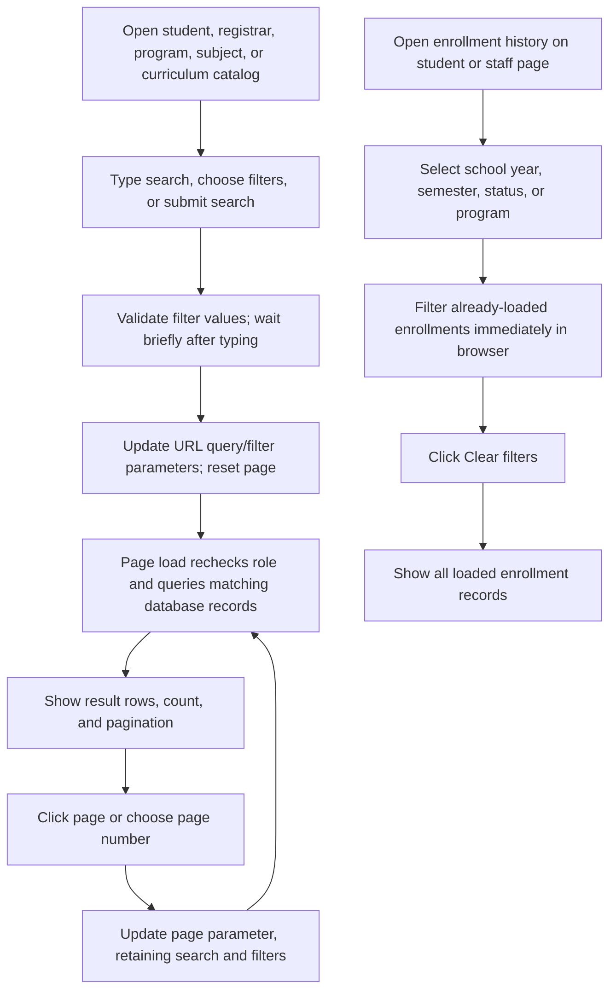

- Student program filter is searchable and gets options from all programs. Section choices are A–D; year/semester options use stored academic values.
- Student academic filters follow the linked current enrollment, not any historical enrollment. **Has current enrollment** checks whether a linked record exists; a linked dropped/completed record still counts as present.
- **Masterlist** (`/user/masterlist`) is available to admin and registrar. School year, semester, searchable program, year level, and section dropdowns update results automatically. It defaults to the latest recorded enrolled/completed term and lists enrolled/completed records from that specific term, including historical classes even after a student changes program or section. Dropped/voided attempts and students without an enrollment are excluded; voided-only academic values do not supply filter options. There is no name search, Apply button, or pagination: 50 students load initially, with additional batches loaded on scroll or **Load more** until all matching students appear. Each batch rechecks staff access and retains the selected term and class. Changing filters cancels pending row requests and starts a fresh list; failed batches offer **Retry**. Student names open profiles and **View** opens that term's enrollment. **Reset filters** returns to the latest term.
- **Download CSV** exports the entire filtered masterlist, including students not yet loaded on screen. The file includes a class/term heading, a blank row, and **No., Student ID, Surname, Given Name, Middle Name** columns using saved name parts and surname order. Empty middle names stay blank. UTF-8 preserves accented names; spreadsheet formulas are neutralized. Exports recheck admin/registrar access, exclude dropped/voided records, and use private, non-cacheable responses. Download stays disabled while filter changes are pending or failed so it cannot export a different scope from the selected filters.
- Setup/verification filters concern account setup, not an enrollment pending state. Enrollment statuses are `enrolled`, `completed`, `dropped`, and `voided`.
- History's **Current** badge means the record matches `currentEnrollmentId`; it is independent of enrollment status. The ordinary `enrolled` badge is omitted while other statuses remain visible.
- History filters do not write to the database. Staff history links open an enrollment detail record; students review their history read-only.

### Certificate of Registration (COR)

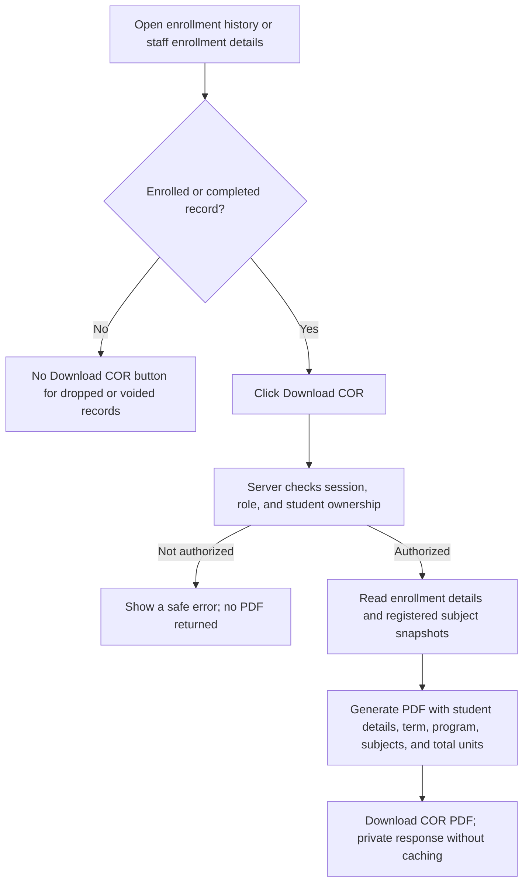

Admin and registrar can download any eligible student's COR. Students can download only their own, including completed historical terms. The server rechecks enrollment status on every request to `/user/enrollment/[enrollmentId]/cor`; hiding the button is not the authorization boundary. Subject codes, names, and custom units come from that enrollment's saved subjects, rather than the current catalog or curriculum. The COR includes program name and code, sex, and birth date. Missing personal fields display **Not recorded**. Downloads include no grades, fees, payment details, signatures, seals, or account secrets. Long values wrap, and long subject lists continue across pages with repeated headings. Staff downloads are also available from the current-enrollment card.

Student creation and editing require birth date and sex, stored on the student record and displayed in student details, profile, and COR. Birth dates use `YYYY-MM-DD` calendar dates; invalid or future dates are rejected. Student and registrar accounts require first and last names; middle name is optional and stored as an empty string when omitted. Name parts are stored on `user`, and both creation and editing compose `user.name` from them. Admins can edit registrar details through **Edit registrar** in the account dropdown. Students cannot edit names through the generic auth API.

Migration `0032_required_personal_details` requires a fresh account database, matching the planned reset of disposable data. It refuses to run while accounts or student records exist instead of guessing names or birth dates. Reset the disposable database, run migrations, and seed the initial admin before starting the updated application. The guarded rollback in `drizzle/rollback/0032_required_personal_details.sql` is available only before accounts exist and refuses newer migrations.

[Example COR PDF](examples/certificate-of-registration.pdf) uses fictional data and is marked **NOT VALID FOR REGISTRATION**. Regenerate with `pnpm exec tsx scripts/generate-cor-example.ts`; see [example documentation](examples/README.md).

## 15. Email settings

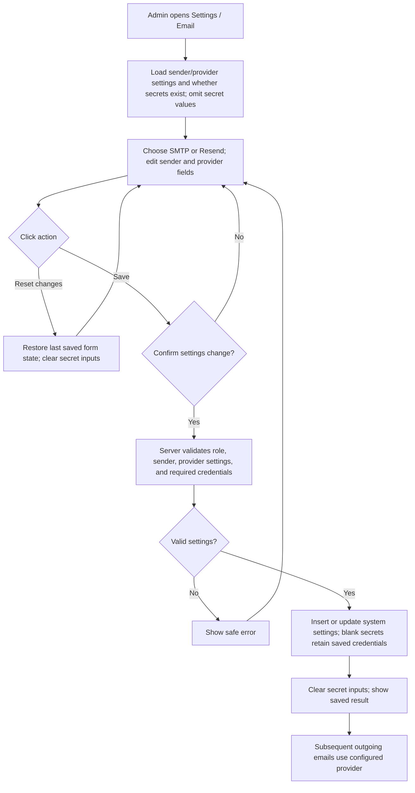

Saving settings does not send a test email. Password/API-key visibility controls only show or hide newly entered values; existing secrets are not loaded into the page.

| Trigger                                           | Email attempt                                            | Saved state if delivery fails                                                      |
| ------------------------------------------------- | -------------------------------------------------------- | ---------------------------------------------------------------------------------- |
| Create student                                    | Account setup link                                       | Student remains; invitation failure can be shown                                   |
| Create registrar                                  | Account setup link                                       | Registrar remains; action can show error                                           |
| Resend verification                               | Account setup link                                       | Account remains                                                                    |
| Forgot password                                   | Reset/setup link for an existing account                 | Account remains; request UI does not establish receipt                             |
| Enroll Student                                    | Enrollment confirmation                                  | Enrollment remains saved                                                           |
| Finalize grades                                   | Finalized-grades notice with program/term                | Grades remain finalized                                                            |
| Send meeting request                              | Request to arrange a meeting                             | Send claim released on delivery failure; retry allowed                             |
| Drop enrollment                                   | Dropped-enrollment notice                                | Enrollment remains dropped                                                         |
| Correct enrollment                                | Corrected-enrollment notice with program/term and reason | Correction, audit, and notification remain saved                                   |
| Void enrollment                                   | Voided-enrollment notice with program/term and reason    | Voided record, audit, notification, and restored current pointer remain saved      |
| Reopen enrollment                                 | Reopened-enrollment notice with program/term and reason  | Grades remain unfinalized; requirements reset; audit and notification remain saved |
| Save grades, verify clearance, complete follow-up | No automatic email                                       | Action's database update applies normally                                          |

Enrollment/finalization/drop/correction/void/reopen commands report the email result separately from database success. They do not automatically retry failed lifecycle emails. Finalizing again after an admin reopens an enrollment sends a new finalized-grades notice. Meeting-request state is recorded only after provider acceptance; provider acceptance is not proof of inbox delivery.

## 16. Errors and shared controls

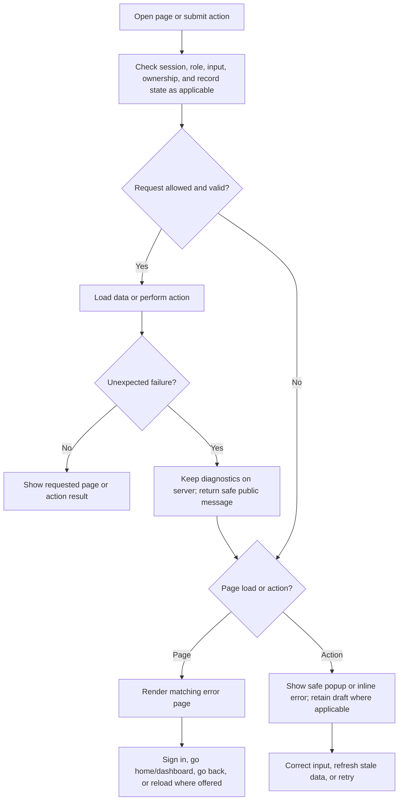

| Control or case                                        | Current effect                                                                                          |
| ------------------------------------------------------ | ------------------------------------------------------------------------------------------------------- |
| Open `/user/*` without sign-in                         | User layout redirects to `/login`; individual protected loads/commands also enforce authentication      |
| Unauthorized protected action                          | 401; no database mutation                                                                               |
| Wrong role                                             | 403; no database mutation                                                                               |
| Missing record or student's unauthorized curriculum ID | 404                                                                                                     |
| Changed/stale record or unmet workflow requirements    | 409 or actionable validation response                                                                   |
| Unexpected server failure                              | Generic public message; internal details stay on server                                                 |
| Error-page Back                                        | Browser back; home fallback if no prior entry                                                           |
| Error-page retry                                       | Reload current path/query when retry is offered                                                         |
| Top-bar Back                                           | Explicit student parent route on enrollment screens; otherwise return to the current navigation section |
| Sidebar link                                           | Navigate to permitted page                                                                              |
| Sidebar Settings group                                 | Expand/collapse navigation links                                                                        |
| Theme control                                          | Toggle light/dark UI; no academic data change                                                           |
| Password visibility                                    | Toggle input masking; no account change                                                                 |
| Modal Cancel/close                                     | Close form; no save                                                                                     |
| Confirmation No/Cancel                                 | Stop pending operation; no save                                                                         |
| Curriculum/enrollment/grade unsaved-work prompt        | Keep draft on cancel; discard and navigate on confirmation                                              |

## 17. Notification inbox and unfinished controls

Notifications use saved backend events. The table also identifies remaining unfinished controls:

| Screen/control                      | What actually happens now                                                                                                                                                                                                                                                           |
| ----------------------------------- | ----------------------------------------------------------------------------------------------------------------------------------------------------------------------------------------------------------------------------------------------------------------------------------- |
| Student dashboard notification list | Recent saved messages addressed to the student; recipient read state persists                                                                                                                                                                                                       |
| Notifications page                  | Saved events with search, email-type filters, pagination and All/Unread views                                                                                                                                                                                                       |
| Notifications: open row             | Show safe message details and persist read status only for the student recipient                                                                                                                                                                                                    |
| Notifications: Mark all as read     | Student recipients mark their own notifications read; staff have no read controls                                                                                                                                                                                                   |
| Reports                             | Admin/registrar can generate enrollment summaries, grade reports, attention lists, completion reports, and dropped enrollment reports; export CSV or print/Save as PDF                                                                                                              |
| Revoke sessions                     | Confirm sign-out on all devices. Better Auth revokes all target sessions without changing password or access; admins can target students/registrars, registrars can target students only                                                                                            |
| Student Edit/Delete                 | Editing remains unavailable. Admin/registrar can confirm deletion only while setup is incomplete and no current or historical enrollment exists; server rechecks atomically and removes linked auth data and reset tokens                                                           |
| Registrar Delete account            | Admin confirms permanent deletion; login data and reset tokens are removed atomically. Student enrollments, subjects, grades, and notifications remain; deleted staff author references become null. Disable account remains available for temporary suspension                     |
| Registrar access                    | Admin confirms Disable/Enable. Better Auth ban/unban APIs control sign-in; disabling revokes active sessions and retains account/history. Actions use the shared dropdown. Setup-link resend is available for enabled, unfinished accounts; admins can also confirm Revoke sessions |
| Profile editing                     | Read-only page; no save action                                                                                                                                                                                                                                                      |
| Two-factor account flow             | Auth plugin exists, but no complete dedicated verification/enrollment UI in current pages                                                                                                                                                                                           |

The inbox and student dashboard use saved events matching outgoing email types. Academic event notifications are saved with their state changes even if email delivery fails; meeting-request events are saved after successful delivery. Account notifications contain safe setup/reset text only, never one-time links or tokens. The top-bar badge uses the same server-enforced visibility; unread badges are shown only for student recipients. Historical events are not backfilled.

**Reports:** changing the report, school year, semester, program, year level, or section updates results automatically. Rapid dropdown changes are grouped into one request; failed updates offer **Retry**. Print and CSV controls wait until the update finishes. Reports use that term's enrollment records, not current class assignments. Enrollment summary counts include dropped attempts and show distinct student counts separately. Other academic reports exclude dropped attempts; the dropped report lists them explicitly. Every report, export, and academic filter-option query excludes voided records. Draft grade outcomes remain Pending, finalized null grades are INC, and next-term readiness follows the same failed-grade meeting rule as enrollment. Historical enrollments are labeled rather than presented as ready for reenrollment. **Download CSV** exports all matching rows with spreadsheet formula protection and rechecks staff permissions. **Print / PDF** prints the complete generated report with scope and Manila timestamp, omitting workspace controls. Reports do not change student or enrollment data.

## 18. Backend action index

Exported remote commands are covered above. Source links are relative to this document.

| Source                                                          | Command                        | Workflow                                                                                                               |
| --------------------------------------------------------------- | ------------------------------ | ---------------------------------------------------------------------------------------------------------------------- |
| [user.remote.ts](../src/lib/actions/user.remote.ts)             | `createStudent`                | Create personal record and account, assign student number, request setup email                                         |
| same                                                            | `createRegistrar`              | Create registrar account and request setup email                                                                       |
| same                                                            | `updateStudent`                | Staff edit personal details and name parts; synchronize display name and protect email changes                         |
| same                                                            | `updateRegistrar`              | Admin edit registrar name parts and email with stale-form and session safeguards                                       |
| same                                                            | `deleteStudent`                | Atomically delete an unfinished student only if no enrollment history exists; preserve student numbering               |
| same                                                            | `setRegistrarDisabled`         | Admin-only Better Auth ban/unban for registrar accounts                                                                |
| same                                                            | `deleteRegistrar`              | Admin-only permanent registrar deletion; preserve academic records and student notifications                           |
| same                                                            | `revokeAccountSessions`        | Role-scoped Better Auth session revocation for student/registrar accounts                                              |
| same                                                            | `resendMagicLink`              | Request account setup/reset link                                                                                       |
| same                                                            | `enrollStudent`                | Validate and save enrollment, subjects, current pointer; attempt email                                                 |
| [enrollment.remote.ts](../src/lib/actions/enrollment.remote.ts) | `correctEnrollment`            | Correct permitted unfinalized enrollment; retain matching grades, audit before/after, notify student and attempt email |
| same                                                            | `voidEnrollment`               | Void incorrect unfinalized enrollment; preserve history, restore current pointer, audit, notify and attempt email      |
| same                                                            | `reopenEnrollment`             | Admin-only reopen with reason; reset finalization/clearance/meeting/follow-up, audit, notify and attempt email         |
| [password.remote.ts](../src/lib/actions/password.remote.ts)     | `resetPasswordAndSignIn`       | Consume reset token, change password, attempt sign-in                                                                  |
| same                                                            | `completeFirstLogin`           | Mark account setup complete and email verified                                                                         |
| [grades.remote.ts](../src/lib/actions/grades.remote.ts)         | `updateEnrollmentGrades`       | Save permitted grade changes with conflict detection                                                                   |
| same                                                            | `finalizeEnrollmentGrades`     | Release reviewed grades and attempt email                                                                              |
| same                                                            | `verifyEnrollmentClearance`    | Mark clearance verified and enrollment completed                                                                       |
| same                                                            | `sendEnrollmentMeetingRequest` | Claim/send/record meeting email                                                                                        |
| same                                                            | `completeEnrollmentFollowUp`   | Timestamp completed follow-up                                                                                          |
| same                                                            | `dropEnrollment`               | Drop current active enrollment and attempt email                                                                       |
| [curriculum.remote.ts](../src/lib/actions/curriculum.remote.ts) | `createCurriculum`             | Save draft and subject snapshots                                                                                       |
| same                                                            | `updateCurriculum`             | Edit unarchived, unpublished draft                                                                                     |
| same                                                            | `activateCurriculum`           | Publish/select curriculum and archive previous selection                                                               |
| same                                                            | `changeCurriculumState`        | Archive, unarchive, or deactivate                                                                                      |
| same                                                            | `deleteCurriculum`             | Delete if not selected or referenced by enrollment                                                                     |
| [program.remote.ts](../src/lib/actions/program.remote.ts)       | `createProgram`                | Create catalog program                                                                                                 |
| same                                                            | `updateProgram`                | Update details/status and optional active curriculum                                                                   |
| same                                                            | `deleteProgram`                | Delete if no curriculum references program                                                                             |
| same                                                            | `setProgramStatus`             | Dedicated status command; current UI uses program form instead                                                         |
| [subject.remote.ts](../src/lib/actions/subject.remote.ts)       | `createSubject`                | Create catalog subject                                                                                                 |
| same                                                            | `updateSubject`                | Update catalog details/status                                                                                          |
| same                                                            | `deleteSubject`                | Delete if no curriculum references subject                                                                             |
| same                                                            | `setSubjectStatus`             | Dedicated status command; current UI uses subject form instead                                                         |
| [settings.remote.ts](../src/lib/actions/settings.remote.ts)     | `updateSystemSettings`         | Save outgoing-email settings                                                                                           |

Additional source owners: [enrollment rules](../src/lib/server/enrollment.ts), [enrollment correction and audit](../src/lib/server/enrollment-corrections.ts), [grade permissions and student history](../src/lib/server/student-enrollment.ts), [curriculum publication](../src/lib/server/curriculum.ts), [dashboard data](../src/lib/server/student-dashboard.ts), [staff enrollment buttons](../src/routes/user/students/EnrollmentDetails.svelte), [enrollment editor](../src/routes/user/students/EnrollmentEditor.svelte), [navigation](../src/lib/components/Sidebar/navigation.ts), [authentication](../src/lib/server/auth.ts), and [public errors](../src/lib/errors.ts).
